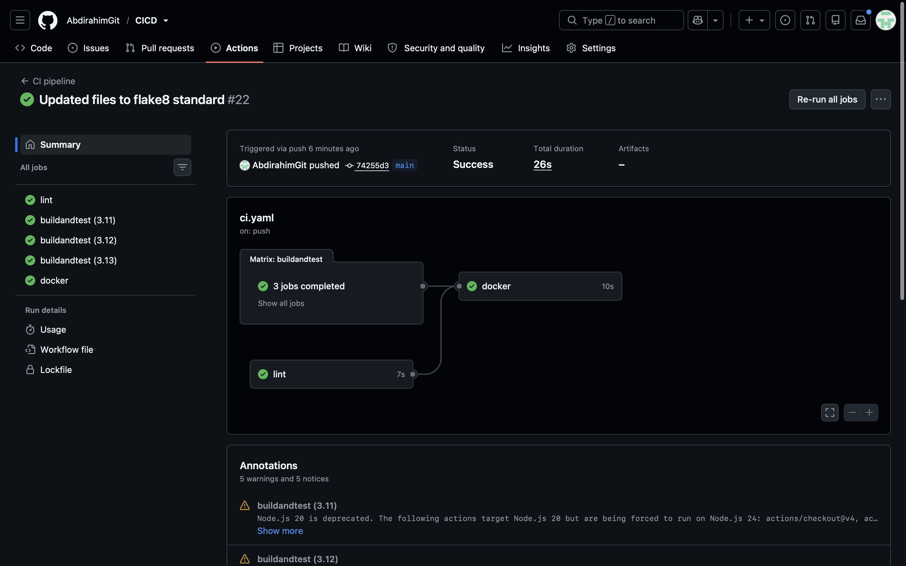
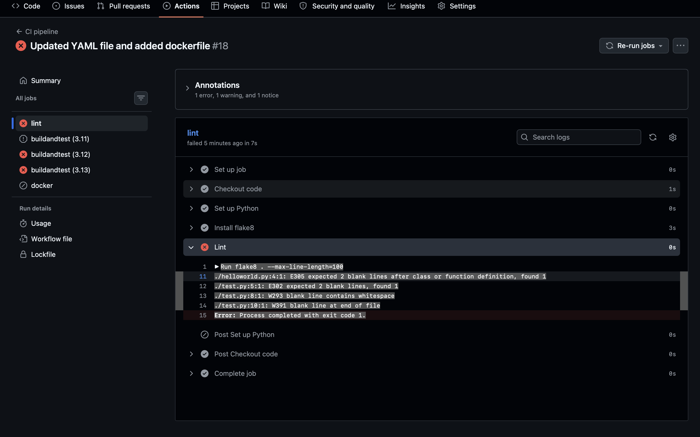
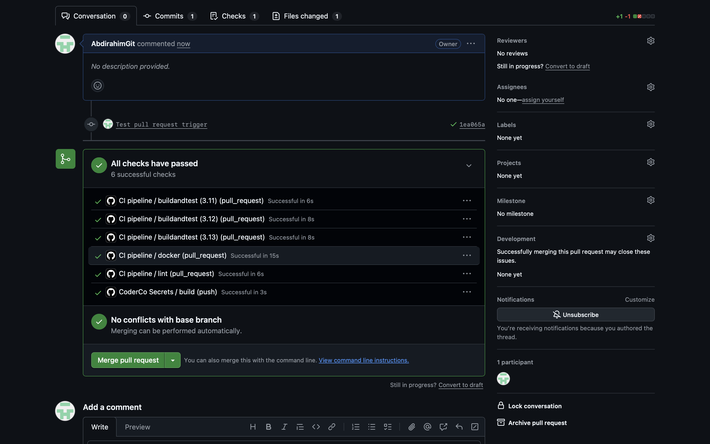
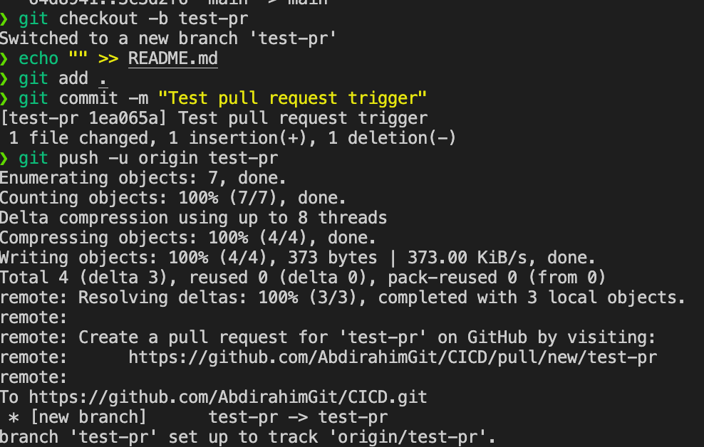

# CI Pipeline with GitHub Actions


A basic Continuous Integration pipeline that automatically checks a small Python project on every push and pull request. It lints the code, runs unit tests on multiple Python versions, and checks that the Dockerfile lints and the image builds.

## What the pipeline does

The workflow is defined in `.github/workflows/ci.yaml` and contains three jobs:

| Job | What it checks | Tools |
|---|---|---|
| `lint` | Python code style and common mistakes | flake8 |
| `buildandtest` | Unit tests pass on Python 3.11, 3.12 and 3.13 (matrix, run in parallel) | unittest |
| `docker` | Dockerfile follows good practice and the image builds | Hadolint, Docker |

`lint` and `buildandtest` run in parallel. The `docker` job uses `needs` so it only starts once both have passed. If code fails linting or tests, no Docker image is built.

```
push / PR ──> lint ───────────┐
              buildandtest ───┴──> docker (lint Dockerfile -> build image)
              (3.11 / 3.12 / 3.13)
```

## Triggers

| Trigger | When it runs |
|---|---|
| `push` | Pushes to `main` |
| `pull_request` | Pull requests targeting `main` |
| `workflow_dispatch` | Manually, using the **Run workflow** button in the Actions tab |

## Project structure

```
CICD/
├── .github/workflows/ci.yaml   # the pipeline
├── Task1/
│   ├── helloworld.py           # application code
│   ├── test.py                 # unit tests
│   └── dockerfile              # container definition
└── README.md
```

## Run the checks locally

```bash
cd Task1

# Lint
pip install flake8
flake8 . --max-line-length=100

# Unit tests
python3 -m unittest discover -v

# Docker
docker build -t hello-app .
docker run --rm hello-app
```

## Screenshots

### 1. All jobs passing

The final push run: `lint` and the three matrix test jobs run in parallel, then `docker` runs after they complete.



### 2. Lint catching real problems

An earlier run failed because flake8 found style errors (missing blank lines, whitespace on a blank line, an extra blank line at the end of the file). `docker` was skipped, showing the gate working.



### 3. Lint passing after the fix

The `lint` job after the code was updated to flake8 standard: flake8 installs, runs and exits cleanly.


### 4. Docker lint failing on a broken Dockerfile

Hadolint rejected the Dockerfile. The `Build image` step was skipped because the earlier step failed, so a broken image never gets built.


### 5. The cause: a typo in the Dockerfile

`FROST` instead of `FROM` on the first line. VS Code underlines it, and Hadolint reported an unexpected `F` on line 1.


### 6. Pull request trigger

Opening a pull request from the `test-pr` branch into `main` automatically starts the pipeline. The checks box shows every job running on the `pull_request` event, and GitHub reports **All checks have passed** before the merge button is available.



### 7. Creating the pull request branch

The commands used to create the `test-pr` branch, commit a small change and push it. GitHub then offers to open a pull request.



## Problems I hit and how I fixed them

- **flake8 errors (E302, E305, W293, W391):** missing blank lines around functions, whitespace on a blank line, and an extra blank line at the end of the file. Fixed by reformatting the files to flake8 standard.
- **`ModuleNotFoundError` in tests:** the test imported a module name that did not match the real file name. Fixed by making the import match the file.
- **Dockerfile typo (`FROST`):** caught by Hadolint in the pipeline before the image was built.
- **YAML indentation:** wrong spacing changes what a line belongs to, so every nested key needs consistent 2-space indentation.

## What I learned

- CI catches mistakes automatically on every push and pull request, before they reach `main`.
- Jobs run in parallel by default, and `needs` makes one job wait for others.
- A matrix runs the same job across several settings (here, three Python versions).
- A pipeline is only proven once you have seen each check fail and then pass.